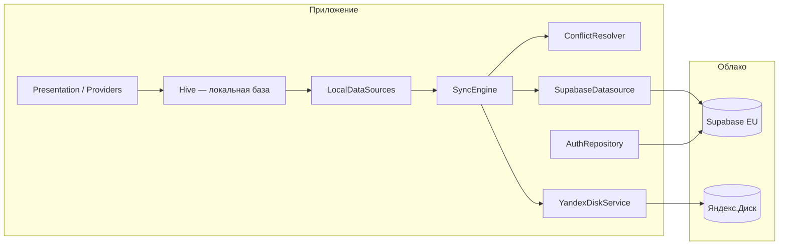

# Архитектура новой синхронизации (R-003/R-029/R-030)

Дата: 2026-11-18. Статус: инфраструктура (заглушки) — задача 2.1.

## Гибридная модель

- **Записи** (растения, поливы, заметки, зимовка, QR-метаданные) — **Supabase**, европейский дата-центр (R-030).
- **Фото** — **Яндекс.Диск** (отдельное подключение, R-029).
- **Аутентификация** — почта + пароль через Supabase Auth (R-029).
- **Без аккаунта** — локальный режим, синхронизация отключена (R-029).

## Диаграмма



## Потоки данных

### Push (локальные изменения → облако)

1. Любое изменение пишется в Hive и помечается `lastModified` + флаг «грязная запись» (очередь на отправку).
2. `SyncEngine.pushLocalChanges()` выбирает грязные записи, преобразует через `toJson()` → `SupabaseDatasource.uploadPlant()`.
3. Фото: файл кладётся на Яндекс.Диск, в запись пишется публичный URL.
4. При успехе — снятие флага «грязная»; при ошибке — запись остаётся в очереди.

### Pull (облако → локальная база)

1. `SyncEngine.pullRemoteChanges()` тянет записи с `lastModified > lastSync` (инкрементально).
2. Каждая запись сливается с локальной через `ConflictResolver`.
3. `lastSync` обновляется серверным временем последней пачки.

## Конфликты

**Last-writer-wins по `lastModified` (серверное время).**

- `remote.lastModified > local.lastModified` → берём remote;
- иначе — local (и она уедет при следующем push);
- `isDeleted` — tombstone-записи: удаление побеждает редактирование при равном времени.

Часы клиента не доверяем: при push сервер проставляет `server_updated_at`, pull использует его.

## Офлайн-режим

- Все операции — только в Hive, немедленно видны пользователю.
- `NetworkInfo` следит за сетью; при появлении — `SyncEngine.sync()` (push затем pull).
- Без аккаунта Supabase — локальный режим навсегда, ошибок нет (R-029).
- Повторная синхронизация идемпотентна: upsert по `id`/`permanentId`.

## Что уже есть (задача 2.1)

| Файл | Роль |
|---|---|
| `lib/core/auth/auth_state.dart` | `AuthStatus`, `AuthUser` |
| `lib/core/auth/auth_repository.dart` | интерфейс входа/регистрации |
| `lib/core/auth/supabase_auth_repository.dart` | заглушка реализации |
| `lib/core/sync/sync_record.dart` | базовая модель записи |
| `lib/core/sync/sync_engine.dart` | интерфейс движка, `SyncStatus` |
| `lib/core/sync/stub_sync_engine.dart` | заглушка движка |
| `lib/core/sync/conflict_resolver.dart` | интерфейс разрешения конфликтов |
| `lib/data/datasources/remote/supabase_datasource.dart` | заглушка удалённого источника |

## Следующие задачи

- **2.2** — подключение Supabase (инициализация, env-ключи, экран входа почта+пароль).
- **2.3** — `SyncEngine` push: очередь грязных записей.
- **2.4** — pull + `ConflictResolver` (last-writer-wins).
- **2.5** — фото: Яндекс.Диск + привязка URL к записям.
- **2.6** — миграция существующих данных пользователя.

## Push + outbox + серверное время (задача 2.3)

### Поток

```
CRUD (PlantCrudProvider) → outbox.enqueue(permanentId, op)
        ↓
SyncOutbox (Hive 'sync_outbox', JSON {id, op, queuedAt})
        ↓ PushSyncEngine.pushLocalChanges()
   op=delete → remote.deletePlant (tombstone is_deleted=true)
   op=upsert → PlantRepository → plantToSyncRow → remote.uploadPlant (upsert)
        ↓ успех
   outbox.remove(id) + sync_metadata.last_sync_at = now()
```

### Правила outbox

- Ключ = `permanent_id`: повторный `enqueue` перезаписывает запись (нет дублей).
- `delete` приоритетнее `upsert`: если в очереди уже delete, повторный upsert его не отменяет.
- Ошибка сети → запись остаётся, статус `error`, ретрай при следующем `sync()`.

### Серверное время (R-045)

- Триггер `plants_set_last_modified` (миграция 00002) ставит `last_modified = now()` на каждый INSERT/UPDATE.
- Клиент **никогда** не отправляет `last_modified` в upsert — часы устройств не участвуют в конфликтах.
- `is_deleted` — tombstone: удаление синхронизируется как обновление, не физическое удаление.

### Локальный режим

Без `AuthRepository.currentUser` push — no-op: очередь копится локально и уйдёт при входе (R-008).
