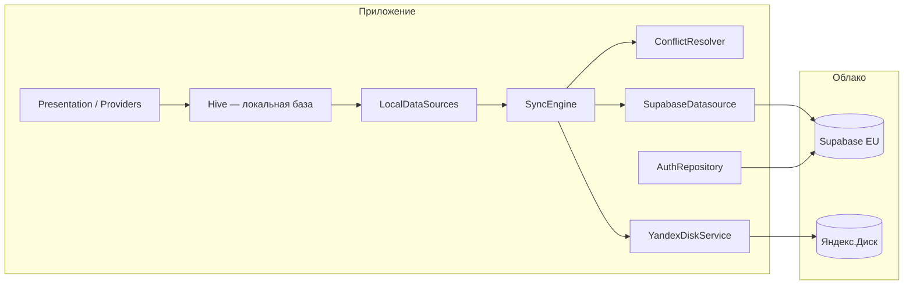

# Архитектура новой синхронизации (R-003/R-029/R-030)

Дата: 2026-11-18. Статус: инфраструктура (заглушки) — задача 2.1.

## Гибридная модель

- **Записи** (растения, поливы, заметки, зимовка, QR-метаданные) — **Supabase**, европейский дата-центр (R-030).
- **Фото** — **Яндекс.Диск** (отдельное подключение, R-029).
- **Аутентификация** — почта + пароль через Supabase Auth (R-029).
- **Без аккаунта** — локальный режим, синхронизация отключена (R-029).

## Диаграмма



## Потоки данных

### Push (локальные изменения → облако)

1. Любое изменение пишется в Hive и помечается `lastModified` + флаг «грязная запись» (очередь на отправку).
2. `SyncEngine.pushLocalChanges()` выбирает грязные записи, преобразует через `toJson()` → `SupabaseDatasource.uploadPlant()`.
3. Фото: файл кладётся на Яндекс.Диск, в запись пишется публичный URL.
4. При успехе — снятие флага «грязная»; при ошибке — запись остаётся в очереди.

### Pull (облако → локальная база)

1. `SyncEngine.pullRemoteChanges()` тянет записи с `lastModified > lastSync` (инкрементально).
2. Каждая запись сливается с локальной через `ConflictResolver`.
3. `lastSync` обновляется серверным временем последней пачки.

## Конфликты

**Last-writer-wins по `lastModified` (серверное время).**

- `remote.lastModified > local.lastModified` → берём remote;
- иначе — local (и она уедет при следующем push);
- `isDeleted` — tombstone-записи: удаление побеждает редактирование при равном времени.

Часы клиента не доверяем: при push сервер проставляет `server_updated_at`, pull использует его.

## Офлайн-режим

- Все операции — только в Hive, немедленно видны пользователю.
- `NetworkInfo` следит за сетью; при появлении — `SyncEngine.sync()` (push затем pull).
- Без аккаунта Supabase — локальный режим навсегда, ошибок нет (R-029).
- Повторная синхронизация идемпотентна: upsert по `id`/`permanentId`.

## Что уже есть (задача 2.1)

| Файл | Роль |
|---|---|
| `lib/core/auth/auth_state.dart` | `AuthStatus`, `AuthUser` |
| `lib/core/auth/auth_repository.dart` | интерфейс входа/регистрации |
| `lib/core/auth/supabase_auth_repository.dart` | заглушка реализации |
| `lib/core/sync/sync_record.dart` | базовая модель записи |
| `lib/core/sync/sync_engine.dart` | интерфейс движка, `SyncStatus` |
| `lib/core/sync/stub_sync_engine.dart` | заглушка движка |
| `lib/core/sync/conflict_resolver.dart` | интерфейс разрешения конфликтов |
| `lib/data/datasources/remote/supabase_datasource.dart` | заглушка удалённого источника |

## Следующие задачи

- **2.2** — подключение Supabase (инициализация, env-ключи, экран входа почта+пароль).
- **2.3** — `SyncEngine` push: очередь грязных записей.
- **2.4** — pull + `ConflictResolver` (last-writer-wins).
- **2.5** — фото: Яндекс.Диск + привязка URL к записям.
- **2.6** — миграция существующих данных пользователя.

## Push + outbox + серверное время (задача 2.3)

### Поток

```
CRUD (PlantCrudProvider) → outbox.enqueue(permanentId, op)
        ↓
SyncOutbox (Hive 'sync_outbox', JSON {id, op, queuedAt})
        ↓ PushSyncEngine.pushLocalChanges()
   op=delete → remote.deletePlant (tombstone is_deleted=true)
   op=upsert → PlantRepository → plantToSyncRow → remote.uploadPlant (upsert)
        ↓ успех
   outbox.remove(id) + sync_metadata.last_sync_at = now()
```

### Правила outbox

- Ключ = `permanent_id`: повторный `enqueue` перезаписывает запись (нет дублей).
- `delete` приоритетнее `upsert`: если в очереди уже delete, повторный upsert его не отменяет.
- Ошибка сети → запись остаётся, статус `error`, ретрай при следующем `sync()`.

### Серверное время (R-045)

- Триггер `plants_set_last_modified` (миграция 00002) ставит `last_modified = now()` на каждый INSERT/UPDATE.
- Клиент **никогда** не отправляет `last_modified` в upsert — часы устройств не участвуют в конфликтах.
- `is_deleted` — tombstone: удаление синхронизируется как обновление, не физическое удаление.

### Локальный режим

Без `AuthRepository.currentUser` push — no-op: очередь копится локально и уйдёт при входе (R-008).

## Pull + конфликты + курсор (задача 2.4)

### Инкрементальный pull

```
sync_state['pull_cursor'] (серверное время, null → всё)
        ↓ fetchChangesSince(cursor, limit=1000)
   plants: last_modified > cursor, ORDER BY last_modified ASC,
   ВКЛЮЧАЯ is_deleted = true (tombstones обязательны)
        ↓ для каждой строки — правила ниже
   cursor = last_modified последней строки → sync_state
   повторять, пока страница полная (пагинация)
```

### Правила применения строки

| Условие | Действие |
|---|---|
| `is_deleted=true`, local чистый | удалить локально (без enqueue!) |
| `is_deleted=true`, local dirty | архив `delete_vs_edit` → удалить, снять outbox |
| не удалён, local чистый | применить remote (upsert), stamp=remoteStamp |
| local dirty, remoteStamp ≤ storedStamp | оставить local — уйдёт в push |
| local dirty, remoteStamp > storedStamp | КОНФЛИКТ: архив `edit_vs_edit` (localJson+remoteJson), remote применён (LWW), outbox снят, stamp=remoteStamp |

`stamp:<permanentId>` в `sync_state` — серверный last_modified на момент
последнего push/pull; база сравнения при конфликте.

### Guard от петли

Pull применяет изменения через `RemoteChangeApplier` (PlantCrudProvider)
под флагом `_applyingRemote` — outbox-хуки пропускают enqueue. Без него
pull сам заполнил бы очередь и устроил бесконечный ping-pong.

### Архив конфликтов

`sync_conflicts` (Box<String>, JSON): {type, permanentId, localJson,
remoteJson, at}. `listConflicts()` — для UI восстановления (задача 2.5).
Молчаливых потерь нет (R-024).

### Post-sync

После успешного pull движок вызывает `onPullComplete` — в main.dart
зарегистрирована перезагрузка провайдеров (watering/wintering/photo/crud).

## Legacy settings sync (задача 2.4б)

Глобальные поливы, зимовка и adultImages жили только в SharedPreferences —
на втором устройстве не обновлялись. Теперь синхронизируются через таблицу
`user_settings` (PK = user_id+key, RLS, триггер last_modified — миграция 00003).

### Ключи (SharedPreferences ↔ user_settings.key)

| PrefsKeys | Тип | Sync |
|---|---|---|
| global_watering_dates | StringList ISO | ✔ |
| wintering_start | String ISO/'' | ✔ |
| wintering_end | String ISO/'' | ✔ |
| wintering_temp | double | ✔ |
| wintering_log | StringList JSON | ✔ |
| adult_images | String JSON map | ✔ |
| search_history / qr_scan_history | — | ✗ локальны намеренно (R-047) |

### Поток

- Push: `_save()` в Watering/Wintering/Photo провайдерах →
  `outbox.enqueue('settings:<key>','upsert')` → `SettingsSyncAdapter.readLegacy`
  → `upsertSetting` (value jsonb, user_id явно, без client last_modified).
- Pull: `fetchSettingsSince(settings_cursor)` — отдельный курсор в sync_state;
  tombstone → `prefs.remove(key)`; иначе `writeLegacy` напрямую в prefs
  (без _save-хуков — петли нет). После pull → `onPullComplete` → провайдеры
  перечитывают prefs.
- `updateLastSync` теперь `rpc('sync_now')` — точные серверные часы.

## Wiring + auto-sync (задача 2.5)

Движок подключён к точкам входа; старый Yandex-обмен записями выключен флагом.

### Точки входа (все — `SyncEngine.sync()`, без аккаунта → no-op R-008)

- **Старт**: после загрузки провайдеров → `SyncActions.startup()`
  (`sl<SyncEngine>().sync()` под try/catch).
- **Кнопка «Синхр.»** (нижняя панель): `SyncActions.manual()` → `sync()`.
  SnackBar-ы не тронуты.
- **`SyncActions`** (`lib/core/sync/sync_actions.dart`) — тонкая точка входа,
  подменяемая в тестах.

### Auto-sync (`lib/core/sync/sync_scheduler.dart`, виджеты не тронуты)

- **debounce**: `SyncOutbox.enqueue` → callback → Timer 5с (сбрасывается
  повторными enqueue — один sync на пачку правок).
- **resume**: `WidgetsBindingObserver.didChangeAppLifecycleState(resumed)`.
- **periodic**: `Timer.periodic` 60с.
- Вкл/выкл — локальный флаг `enableAutoCloudSync` (FeatureFlags), без UI.
- Все триггеры уважают «без аккаунта → no-op».

### Legacy record-sync (R-048)

Флаг `legacyYandexRecordSync` (default **false**) gate-ит весь путь
whole-JSON через Яндекс (`syncData`/`loadDataFromCloud`/post-auth sync в
`CloudStorageProvider` + WelcomeScreen через фасад). Записи идут через
Supabase; фото и бэкап — через Яндекс без изменений (R-003 гибрид).
TODO(архив после 2.6) расставлен в точках gate.

## Initial migration + backup/rollback (задача 2.6)

Однократная миграция живой коллекции: локальные данные → Supabase.
Источник истины этапа — ЛОКАЛЬНЫЕ данные. Yandex plant_provider.json
не удаляется и не перезаписывается (остаётся резервной копией).

### Порядок (InitialMigration.run, строгий)

1. Флаг `sync_state['migration_v1_done'] == 'true'` → выход (идемпотентность).
2. Нет аккаунта → выход без флага (отложено до входа, R-008).
3. `MigrationBackup.createBackup()` — ВСЕ plants + 6 legacy-ключей →
   `documents/migration_backup_<ts>.json`; путь в `migration_backup_path`.
4. Bulk enqueue: plants → 'upsert'; 6 ключей → 'settings:<key>' upsert.
5. `engine.sync()` (push → pull).
6. Outbox не пуст → флаг НЕ ставим (частичный сбой, повтор домигрирует).
7. Серверные `last_modified` → `stamp:<id>`; курсоры = `rpc('sync_now')`
   (свои записи не тянутся обратно).
8. `migration_v1_done = true`; сверка counts local/remote → `migration_report`
   + AppLogger (расхождение → error, но работа не прерывается).

`rollback(path)` — восстановление plants+prefs из файла, сброс флага done.
Подключение: `SyncActions.startup()` вызывает `migration.run()` перед sync.

## Кросс-девайс приёмка (задача 2.7)

Автотесты: `test/integration/cross_device_sync_test.dart` (c1–c4, два
движка на общем in-memory сервере). Ручной чек-лист на реальных
устройствах: [docs/ACCEPTANCE_CHECKLIST_2.7.md](../ACCEPTANCE_CHECKLIST_2.7.md).

## Photo Passports: структура и локальный CRUD (этап 3.1)

Фундамент фото-паспортов (R-004/R-005/R-054) — только данные и локальная
логика, без UI и без Яндекс.Диска.

- **`PhotoPassport`** (`lib/core/models/photo_passport.dart`): passportId,
  plantId, versions[], isArchived, isDeleted.
- **`PhotoVersion`**: versionId, yandexFilePath (путь на Диске, НЕ ссылка),
  createdAt, sizeBytes, localCachePath?.
- **`Plant.photoPassports`** — новое поле (userPhotos сохранён для
  обратной совместимости, миграция — шаг 3.2). Персистится через
  `PlantDto.photoPassportsJson` (HiveField 40).
- **`PhotoPassportManager`** (`lib/core/sync/photo_passport_manager.dart`):
  addPhotoVersion (новый паспорт / +версия по passportId — замена = версия),
  archivePassport, deletePassportEverywhere (только флаг + outbox — файл
  на Диске НЕ трогается), freeLocalSpace (сброс кэш-путей),
  getActivePassports (!isDeleted && !isArchived).
- Запрет сетевой валидации: cleanBroken/validateCloudUrl — 0 живых
  вхождений (только комментарии об их удалении).

### Этап 3.2: Supabase-схема, legacy-миграция и path-based upload (R-055)

- **Миграция `00004_add_photo_passports.sql`**: колонка `photo_passports JSONB`
  в `plants` — паспорта едут в Supabase вместе с записью растения
  (мапперы `plantToSyncRow`/`plantFromSyncRow` обновлены).
- **`PhotoMigration`** (`lib/core/sync/photo_migration.dart`): флаг
  `migration_photo_v1_done`; каждый элемент `userPhotos` → `PhotoVersion`
  (yandexFilePath = строка как есть), все версии растения → один
  `PhotoPassport` с `isArchived = true`. `userPhotos` не очищается.
  Вызывается из `InitialMigration.run()` — и в ветке done (для установок,
  мигрированных в 2.6), и после основной миграции.
- **Path-based upload** (`YandexDiskService`): `uploadPhoto` и новый
  `uploadPassportPhoto(filePath, passportId, versionId)` возвращают
  внутренний путь `/MyCactus/photos/{passportId}_{versionId}.{ext}`;
  publish/публичные ссылки НЕ генерируются и НЕ хранятся (R-004/R-005).

### Этап 3.3: UI фото-паспортов (R-056)

`PhotoPassportSection` (presentation/widgets) в `gallery_tab`:
активные паспорта — карточки с «⋮»-меню (В архив / Удалить везде с
диалогом / Освободить место); «Показать архивные фото» → архив +
«Вернуть в галерею». Новые фото → паспорт в `addUserPhoto`;
`photo_sync` грузит версии через `uploadPassportPhoto` (путь, не ссылка);
локальный файл сохраняется в localCachePath.

### Аудит 4.2: единая фото-подсистема + корзина (R-058)

**Единый источник истины — `Plant.photoPassports`.** Legacy-поле
`userPhotos` помечено `@Deprecated`: не используется ни для отображения
(`gallery_tab` строит сетку из активных паспортов —
`localCachePath ?? yandexFilePath` последней версии), ни для загрузки
(`PhotoSyncService.syncUserPhotos` грузит только версии паспортов,
`addUserPhoto` создаёт паспорт и в `userPhotos` не пишет). Поле
оставлено в модели/DTO для истории и обратной совместимости.

**Корзина `photo_trash` (`PhotoTrashService`)** — Hive-бокс `photo_trash`
(Box\<String\>, JSON-записи `{id, paths, now, deleteAfter}`).
`deletePassportEverywhere` кроме флага `isDeleted` + outbox ставит пути
версий в корзину с меткой «удалить при ближайшей синхронизации».
`processTrash` при sync вызывает удаление с `permanently=false`
(Яндекс сам кладёт файл в свою Корзину — откат 30 дней). Из очереди
вычёркиваются ТОЛЬКО успешно удалённые пути; упавшие остаются и
повторяются при следующей синхронизации — ноль потерь очереди.
Legacy-очередь `deletedUserPhotos` обслуживается тем же правилом:
`clearDeletedPhotos()` вызывается лишь при полном успехе, упавшие
дублируются в `photo_trash`. `permanently=true` в коде отсутствует.

**Освобождение места**: `freeLocalSpace` удаляет локальный файл кэша
(`File.deleteSync` в try/catch) и сбрасывает `localCachePath` — место
освобождается реально, а не только в метаданных.

### Conflict archive UI (этап 4.3, R-059)

- **`SyncConflict.id`** — стабильный идентификатор записи = ключ
  Hive-бокса `sync_conflicts` (`permanentId:micros`); `listConflicts()`
  возвращает записи с id, `removeConflict(id)` удаляет конкретную.
- **Вход**: `ConflictArchiveTile` в «О приложении» — виден только при
  `store.length > 0`, показывает счётчик, обновляется после возврата.
- **Экран `/conflicts`** (`conflict_archive_screen.dart`): карточки
  с именем растения (localJson→remoteJson), типом и датой.
  - «Вернуть мою локальную версию» → AlertDialog → `restoreLocalConflict`
    — `Plant.fromJson(localJson)` → `updatePlant` (штатный путь → outbox
    → push на другие устройства) → `removeConflict`.
  - «Оставить облачную» → `keepRemoteConflict` — `removeConflict`,
    облачная версия уже применена движком (LWW).
- Пустой архив — заглушка «Конфликтов нет».
